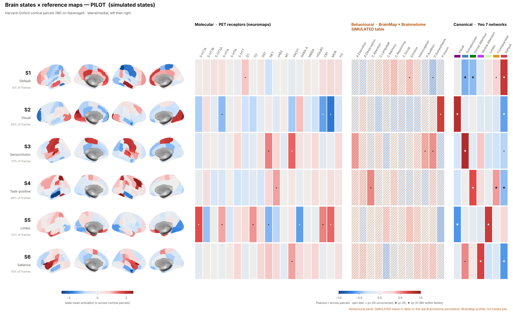

# Piloto: brain states × mapas de referência

Como ler um brain state em termos neuroanatômicos: a ativação média do estado
no córtex e, ao lado, a correlação desse padrão com três famílias de mapas.



| família | o que é | fonte usada aqui | status |
|---|---|---|---|
| **Molecular** | 19 mapas PET de receptores/transportadores (5-HT, DA, NE, ACh, GABA, Glu, CB1, MOR, H3) | conjunto de Hansen et al. 2022, que é o que o `neuromaps` serve como anotações MNI152; baixado do repositório do artigo | **real** |
| **Comportamental** | perfil de domínios comportamentais do BrainMap para cada sub-região do Brainnetome (Fan et al. 2016) | parcelação Brainnetome real (210 regiões corticais, TemplateFlow); **tabela de domínios simulada** | **parcelação real, perfis SIMULADOS** |
| **Canônico** | redes de Yeo 2011 (7 redes) | TemplateFlow, fsaverage5 | **real** |
| **Estados** | médias por estado sobre as 96 parcelas corticais do `harvardoxford` | simulados (veja abaixo) ou `fmri-decomp state-means --csv` | **simulados** neste piloto |

```bash
pilots/state_maps/fetch_reference_maps.sh          # ~280 MB em pilots/state_maps/data/
python pilots/state_maps/pilot.py                  # estados simulados, ~2 min
# com dados reais:
fmri-decomp state-means --atlas harvardoxford --window-s -1 \
    --states HMM2_pca14_10 --csv sm.csv
python pilots/state_maps/pilot.py --state-means sm.csv [--behavioural bna_brainmap.csv]
```

Dependências além do pacote: `nilearn` (`pip install -e ".[atlases]"`) e
`matplotlib`. O `neuromaps` não é necessário; veja a seção sobre ele abaixo.

Saídas em `figures/`:

- `state_maps_overview.png/.pdf`: uma linha por estado, cérebro em 4 vistas (lateral e medial, esquerda e direita) e as três faixas de correlação.
- `state_card_S<k>.png`: um estado em tamanho de leitura, com barras ordenadas por família (top 8 por |r|, todas as 7 redes de Yeo).
- `state_map_correlations.csv`: r, p do spin test e q (FDR) para cada estado × mapa.
- `provenance.json`: de onde veio cada família, o que é simulado e a verdade da simulação.

## Como funciona

**Espaço comum.** Os três tipos de mapa têm formatos diferentes: volume PET em
MNI, tabela por região do Brainnetome e rótulos em fsaverage. O único lugar
onde os três se encontram é a superfície cortical, então tudo vai para o
fsaverage5 (10.242 vértices por hemisfério) e de lá para as **parcelas do
atlas dos estados**. A correlação é calculada entre parcelas (n = 96), com um
valor por parcela dos dois lados.

- PET → superfície por `nilearn.vol_to_surf`, amostrando entre a superfície white e a pial. Os zeros fora da máscara de cada PET são tratados como "não medido", não como zero. Cada mapa é z-scored no córtex.
- Brainnetome: o TemplateFlow só tem o atlas em fsaverage 164k. O fsaverage5 corresponde aos primeiros 10.242 vértices do fsaverage (os icosaedros são aninhados), então a reamostragem é só um corte do array.
- Yeo7: um mapa indicador por rede. Parcelado, ele vira a fração de cada parcela que pertence à rede.
- Harvard-Oxford: o volume `HOCPAL` thr25 é projetado com rótulo mais frequente. Vértices que pegaram o rótulo do outro hemisfério recebem o homólogo do próprio lado, e buracos do thr25 recebem o vizinho mais próximo na esfera.

**Estatística.** Dois mapas cerebrais suaves se correlacionam muito mais do
que dois vetores aleatórios, porque parcelas vizinhas não são independentes. O
p paramétrico sobre 96 parcelas é anticonservador. Por isso o piloto usa o
**spin test** (Alexander-Bloch et al. 2018): o mapa de referência é girado na
esfera (o hemisfério direito recebe a rotação espelhada do esquerdo), parcelado
de novo e correlacionado de novo, 1000 vezes. O FDR (BH) é aplicado dentro de
cada família, sobre todos os pares estado × mapa.

Na figura, `•` marca p < .05 sem correção, `✱` marca q < .05 e `★` marca q < .01.

**Limitação de resolução.** Com 1000 rotações o menor p possível é 1/1001. Com
114 testes na família molecular, o menor q possível fica perto de 0,11, então
nada ali pode sobreviver ao FDR. A melhor correlação molecular, Visual × MOR
(r = −0,74, p_spin = .001), é um exemplo. Para os dados reais, rode com
`--n-spins 10000` (cerca de 10 min).

## Os estados simulados têm resposta conhecida

Cada estado é uma mistura com sinal de redes de Yeo, mais ruído espacialmente
suave (kernel gaussiano de 25 mm entre centróides). O piloto sorteia 6000
frames ruidosos numa cadeia de Markov "pegajosa" e tira a média por rótulo, o
mesmo groupby que o `state-means` faz.

| estado | mistura (verdade) | rede de Yeo recuperada com maior r |
|---|---|---|
| S1 Default | +Default −DorsAttn −SomMot | Default r = .78 ★, DorsAttn −.47 ★, SomMot −.51 ★ |
| S2 Visual | +Visual −Default | Visual .85 ★, Default −.57 ★ |
| S3 Sensorimotor | +SomMot +VentAttn −FPN | SomMot .87 ★ |
| S4 Task-positive | +DorsAttn +FPN −Default | DorsAttn .67 ★, FPN .46 ★, Default −.47 ★ |
| S5 Limbic | +Limbic +Default −Visual | Limbic .77 ★, Visual −.62 ★ |
| S6 Salience | +VentAttn +SomMot −Default | VentAttn .73 ★, Default −.61 ★ |

O painel canônico recupera a mistura em todos os estados, o que valida a
cadeia projeção → parcelamento → correlação → spin. Os padrões moleculares que
aparecem (por exemplo Visual × MOR e CB1 negativos, Sensorimotor × VAChT
positivo) são correlações **reais** entre mapas de receptores e esses padrões
sintéticos. Como os estados são construídos a partir das redes, essas
correlações descrevem as redes, não um achado.

## Por que a parte comportamental está simulada

Os perfis de domínio comportamental do BrainMap por sub-região (forward
inference de Fan et al. 2016) são servidos pelo site atlas.brainnetome.org.
Daqui, o site não respondeu: nem o DNS resolve. Também não estão no repositório
GitHub oficial (`BrainnetomeAtlas/HUMAN-BRAINNETOME-ATLAS`, que só tem o README;
os arquivos ficam em releases/LFS) nem no TemplateFlow.

`refmaps.simulate_behavioural_table` gera uma tabela **no mesmo formato** a
partir de um prior de livro-texto por giro (IFG → linguagem, PrG → execução
motora, MVOcC → visão etc.) mais ruído. A tabela só existe para construir e
testar o painel. A figura marca esse painel com hachura e "SIMULATED" e não
deve ser lida como resultado.

Para usar os perfis reais, monte um CSV com `bn_index` (1..246, numeração do
BNA: ímpar = esquerdo, par = direito) e uma coluna por domínio, com qualquer
escore monotônico (z, razão de verossimilhança ou 0/1). Depois rode com
`--behavioural arquivo.csv`. As linhas subcorticais (211..246) são aceitas e
ignoradas.

## Sobre o `neuromaps`

`pip install neuromaps` funciona, mas `neuromaps.datasets.fetch_annotation`
baixa do OSF, que estava bloqueado neste ambiente. Por isso os PET vêm do
repositório do artigo (`netneurolab/hansen_receptors`), que tem os mesmos
volumes. Num ambiente com OSF dá para trocar por `fetch_annotation` e usar o
`neuromaps.transforms.mni152_to_fsaverage` (registration fusion), que é mais
preciso que a projeção direta do nilearn usada aqui. Também dá para usar o
`neuromaps.nulls` no lugar do spin implementado em `refmaps.py`.

## Decisões a revisitar no projeto real

- **Só córtex.** As 15 parcelas subcorticais do `harvardoxford` são ignoradas e o script lista quais. Uma versão volumétrica (parcelar os PET direto no volume do HO) resolveria isso para a família molecular.
- **Atlas dos estados.** Os estados `yeo7` e `networks` (14 redes) têm poucas parcelas para uma correlação espacial ter poder estatístico. Este painel só faz sentido para `harvardoxford`. Para os outros, o natural é mostrar a média por rede, sem correlação.
- **Yeo7 como correlação ou como média.** Aqui é a correlação com a fração de cada rede. A alternativa, mais direta de ler, é a ativação média do estado dentro de cada rede (um radar plot).
- **Estados de DFC** (janelas de conectividade) não são mapas de ativação. Para eles seria preciso derivar um mapa por parcela, por exemplo a força nodal, antes de entrar aqui.
