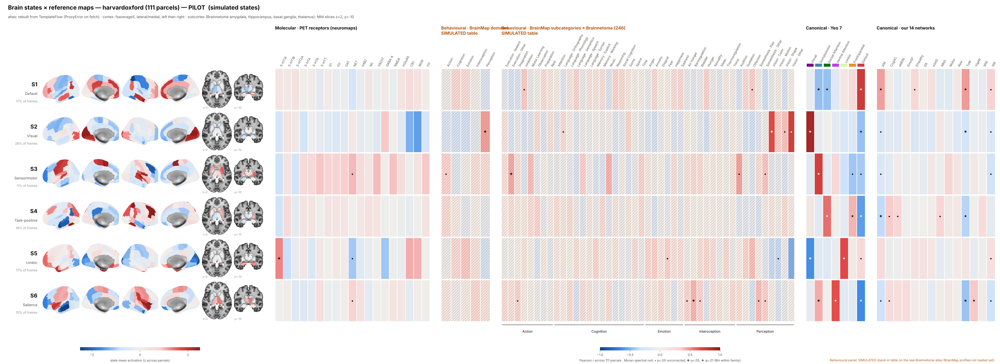

# Piloto: brain states × mapas de referência

Como ler um brain state em termos neuroanatômicos: a ativação média do estado,
no córtex e no subcórtex, e ao lado a correlação desse padrão com quatro
famílias de mapas. Há uma figura para cada atlas do pipeline.



| família | o que é | fonte | status |
|---|---|---|---|
| **Molecular** | 19 mapas PET de receptores/transportadores (5-HT, DA, NE, ACh, GABA, Glu, CB1, MOR, H3) | conjunto de Hansen et al. 2022, que é o que o `neuromaps` serve em MNI152; baixado do repositório do artigo | **real** |
| **Comportamental** | perfil de cada sub-região do Brainnetome na taxonomia do BrainMap, em todas as subcategorias (ex.: Perception → Vision → Motion), agrupadas por domínio | atlas Brainnetome real (246 regiões, **com subcórtex**); **perfis simulados** | **atlas real, perfis SIMULADOS** |
| **Canônico: Yeo 7** | redes de Yeo 2011 | volume liberal MNI152, o mesmo que o `yeo7` do repo usa | **real** |
| **Canônico: nossas 14 redes** | o atlas `networks` deste repo (254 esferas de 5 mm) | `fmri_decomposition.get_atlas("networks")` | **real** |
| **Estados** | médias por estado no atlas em que foram ajustados | simulados, ou `fmri-decomp state-means --csv` | **simulados** neste piloto |

**Pelo notebook:** `notebooks/08_state_maps.ipynb`. Os parâmetros ficam numa
célula só: a definição de cluster (`STATES`, `WINDOW_S`, `COHORTS`), os atlas
mostrados (`ATLASES`), as famílias (`FAMILIES`), a profundidade da taxonomia
comportamental (`BN_LEVELS`: `"domain"`, `"subcategory"` ou os dois) e os
nulos (`N_NULLS`, `NULL`).

O notebook chama dois scripts, que também rodam pela linha de comando:

```bash
pip install -e ".[atlases]" matplotlib openpyxl      # + brainsmash para --null burt
pilots/state_maps/fetch_reference_maps.sh             # uma vez, ~285 MB em data/

# 1. tabelas -> results/<estados>/<atlas>/{state_means,correlations}.csv + provenance.json
python pilots/state_maps/state_correlations.py --states simulate
python pilots/state_maps/state_correlations.py --states HMM2_pca14_10 --window-s -1 \
    --atlases harvardoxford --output-root /caminho/outputs

# 2. figuras, a partir das tabelas (nenhum número é recalculado aqui)
python pilots/state_maps/state_figures.py pilots/state_maps/results/simulated \
    --atlases harvardoxford --bn-levels domain subcategory
```

`--states` aceita `simulate`, uma coluna de estados (lida por
`fmri_decomposition.state_means`, a mesma tabela que o `fmri-decomp state-means`
imprime) ou um CSV do `state-means --csv`.

Saídas em `results/<estados>/<atlas>/`:

- `state_maps_overview.png`: uma linha por estado. Mostra o córtex (lateral e medial, esquerda e depois direita), dois cortes subcorticais (axial z=2 e coronal y=−10) e uma faixa de correlação por família.
- `state_card_S<k>.png`: um estado em tamanho de leitura, com barras ordenadas.
- `correlations.csv`: r, p e q (FDR) para cada estado × mapa.
- `state_means.csv`: os estados, no formato do `state-means --csv`.
- `provenance.json`: de onde vieram o atlas, os estados e cada família, e a verdade da simulação.

## Os nossos atlas

O piloto roda nos quatro atlas que o pipeline extrai, com o código do próprio
repo:

| atlas | parcelas | de onde veio aqui |
|---|---|---|
| `harvardoxford` | 111 (96 corticais + 15 subcorticais) | `get_atlas` primeiro. Como o nilearn baixa do NITRC, que estava bloqueado, o atlas foi **reconstruído pelo mesmo caminho de código** (`plan_harvard_oxford_merge`, `AtlasSpec.from_label_image`) a partir das mesmas imagens FSL vindas do TemplateFlow: os mesmos 111 nomes, na mesma ordem. |
| `networks_nodes` | 254 esferas | `get_atlas`, sem download (o CSV está no repo) |
| `networks` | 14 redes | `get_atlas` |
| `yeo7` | 7 redes | `get_atlas` primeiro. Como o nilearn baixa do servidor do FreeSurfer, que estava bloqueado, o atlas foi reconstruído a partir do mesmo volume (`Yeo2011_7Networks…LiberalMask`, cópia do neuroparc) |

No cluster, onde o cache do nilearn existe, o `get_atlas` funciona direto. O
`provenance.json` registra qual caminho foi usado.

**Tudo é parcelado no espaço do pipeline** (MNI152NLin6Asym, 2 mm) com
`AtlasSpec.membership`. É a mesma matriz que transformou voxels nas séries
temporais em que os estados foram ajustados, então o valor de um mapa na
parcela k é calculado exatamente como o valor do estado na parcela k,
subcórtex incluído. A superfície só entra no desenho.

## Estatística

Mapas cerebrais suaves se correlacionam muito mais do que vetores
aleatórios, porque parcelas vizinhas não são independentes. Por isso o p vem de
**mapas substitutos que preservam a autocorrelação espacial** de cada mapa de
referência, medida pelas distâncias entre os centróides das parcelas. Isso vale
para subcórtex e para atlas de esferas, onde o spin test não se aplica.

- `--null moran` (padrão): Moran spectral randomization (Wagner & Dray 2015, como no BrainSpace), com 10.000 substitutos por mapa (`--n-nulls`). Roda em segundos.
- `--null burt`: variogram matching (Burt et al. 2020, brainsmash). Leva cerca de 45 s por mapa com 111 parcelas e cerca de 2,5 min com 254; com 85 mapas, isso dá horas. É um job de cluster, para a análise final.

O FDR (BH) é aplicado dentro de cada família, sobre todos os pares estado ×
mapa. O número de substitutos importa: o menor p possível é 1/(n+1), e na
família molecular (6 estados × 19 mapas = 114 testes) 1000 substitutos não
deixam nenhum q chegar a .05. Por isso o padrão é 10.000. Na figura, `•` marca p < .05 sem correção, `✱` marca q < .05 e `★` marca
q < .01.

**`yeo7` (7) e `networks` (14) não têm p-valor.** Uma correlação sobre 7 ou 14
pontos é descrição, e nenhum modelo nulo transforma isso em inferência. Para
esses atlas a figura mostra o padrão e as correlações sem marcas.

## Os estados simulados têm resposta conhecida

Cada estado é uma mistura, com sinal, de redes de Yeo e das quatro estruturas
profundas do Brainnetome (amígdala, hipocampo, núcleos da base e tálamo), mais
ruído espacialmente suave. O piloto sorteia 6000 frames ruidosos numa cadeia
de Markov "pegajosa" e tira a média por rótulo, o mesmo groupby do
`state-means`.

| estado | mistura (verdade) |
|---|---|
| Default | +Default −DorsAttn −SomMot +hipocampo |
| Visual | +Visual −Default +tálamo |
| Sensorimotor | +SomMot +VentAttn −FPN +núcleos da base +tálamo |
| Task-positive | +DorsAttn +FPN −Default +núcleos da base |
| Limbic | +Limbic +Default −Visual +amígdala +hipocampo |
| Salience | +VentAttn +SomMot −Default +tálamo +amígdala |

Se o painel de Yeo não recupera a mistura, o problema está no pipeline, não nos
estados. As correlações moleculares são **reais**, mas são entre mapas de
receptores e padrões sintéticos construídos a partir das redes. Descrevem as
redes, não um achado.

## A parte comportamental: taxonomia completa, perfis simulados

O Brainnetome caracteriza cada sub-região pelos rótulos do BrainMap (Fan et al.
2016), que são hierárquicos: domínio → subdomínio → sub-subdomínio. Com `BN_LEVELS` o painel mostra os **5 domínios** (média das subcategorias de
cada um), **todas as folhas**, ou os dois lado a lado. O painel de folhas
mostra, por exemplo `Vision · Motion`, `Language ·
Semantics`, `Somesthesis · Pain`, `Memory · Working`, agrupadas sob os cinco
domínios (Action, Cognition, Emotion, Interoception e Perception).

**Os perfis estão simulados.** Os perfis reais por sub-região estão em
atlas.brainnetome.org, e nem o DNS desse site resolveu daqui; brainmap.org
também não. O atlas em si (volume com as 246 regiões e a tabela de
sub-regiões) veio da cópia que o DPABI distribui. A tabela simulada usa um
prior de livro-texto por giro, refinado para as sub-regiões cujo nome diz mais
(V5/MT+ → Vision·Motion, A41/42 → Audition, A44/45 → Language, A4tl →
Execution·Speech, etc.), mais ruído. A figura marca esse painel com hachura e
"SIMULATED".

A lista de categorias em `refmaps.BRAINMAP_TAXONOMY` foi escrita à mão a partir
da taxonomia publicada, sem consulta à fonte. Confira contra a tabela real; quando ela entrar,
as colunas passam a vir dela.

**Formato da tabela real** (`--behavioural arquivo.csv`): uma coluna
`bn_index` (1..246, numeração do BNA: ímpar = esquerdo, par = direito) e uma
coluna por categoria com o caminho completo (`Perception.Vision.Motion`), com
qualquer escore monotônico (z, razão de verossimilhança ou 0/1). Os grupos de
domínio da figura saem do primeiro nível do nome.

## Sobre o `neuromaps`

`neuromaps.datasets.fetch_annotation` baixa do OSF, que estava bloqueado
neste ambiente. Os PET vêm do repositório do artigo
(`netneurolab/hansen_receptors`), que tem os mesmos volumes. Num ambiente com
OSF dá para trocar por `fetch_annotation` e usar o `neuromaps.nulls`.

## Decisões a revisitar

- **Estados de DFC** (janelas de conectividade) não são mapas de ativação. Para entrarem aqui, é preciso derivar um mapa por parcela, por exemplo a força nodal.
- **`networks_nodes`**: as esferas de 5 mm amostram pouco tecido. Nos mapas PET de baixa resolução (3 mm), uma esfera tem poucos voxels independentes.
- **`harvardoxford` reconstruído vs. nilearn**: o `symmetric_split` do nilearn e a versão lateralizada do FSL (HOCPAL) podem diferir em alguns voxels na linha média. Com os estados reais, use o atlas do cluster.
